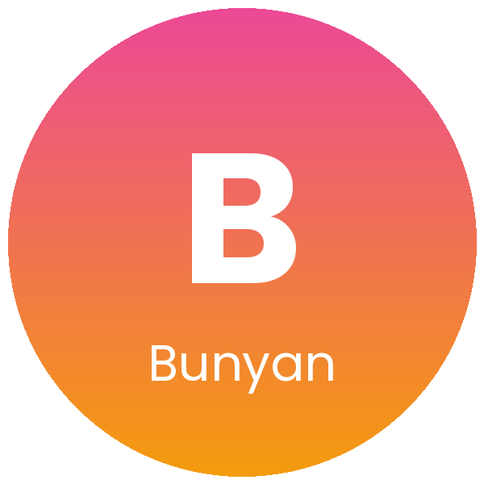

  

  

<h3 align="center">🥽 Bunyan · VR-Based Therapy Solution</h3>

     

---

## 📌 Overview

Bunyan is a VR-based tool that supports children during physiotherapy sessions. It turns therapy into an engaging virtual experience, which improves patient engagement and therapy effectiveness.

---

## ❓ The Problem

Physiotherapy often means repeating the same exercises over many sessions. For children this can feel tiring and boring, which makes it harder for them to stay engaged and can slow down their progress.

## 💡 Our Solution

Bunyan places the child in a virtual reality experience during the session. Instead of repetitive exercises, therapy becomes an interactive experience that keeps children engaged and motivated.

---

## ✨ Key Features

<table>
  <tr>
    <td width="25%" align="center" valign="top"><h2>🥽</h2><b>Virtual reality sessions</b> Supports children with a VR experience during physiotherapy.</td>
    <td width="25%" align="center" valign="top"><h2>🧒</h2><b>Designed for children</b> Built around the needs of young patients.</td>
    <td width="25%" align="center" valign="top"><h2>🎮</h2><b>Higher engagement</b> Makes sessions more engaging for the child.</td>
    <td width="25%" align="center" valign="top"><h2>📈</h2><b>Better therapy outcomes</b> Aims to improve the effectiveness of therapy.</td>
  </tr>
</table>

---

## 🏆 Achievements

| | Achievement |
| :---: | --- |
| 🥉 | **3rd Place in a national-level competition** |

---

## 🌍 Impact Areas

Healthcare innovation · Pediatric rehabilitation · Quality of life

---

## 👩‍💻 Team

Built by **[Roz Alomar](https://github.com/RSA445)**, AI Solutions Builder and Information Systems student at Najran University.

  
  
  

  

